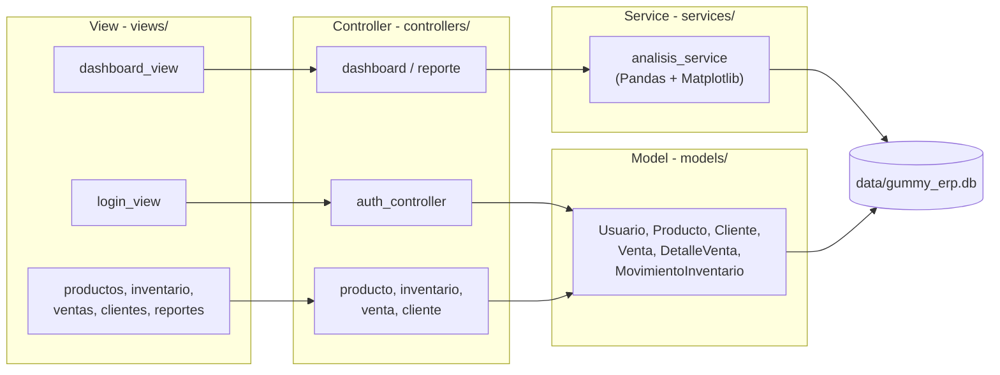
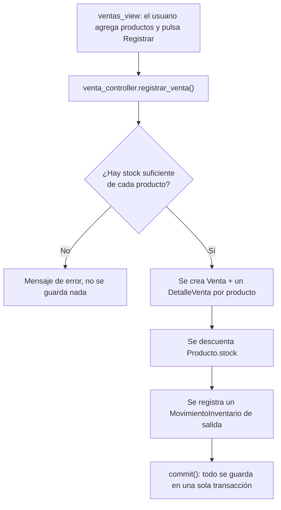
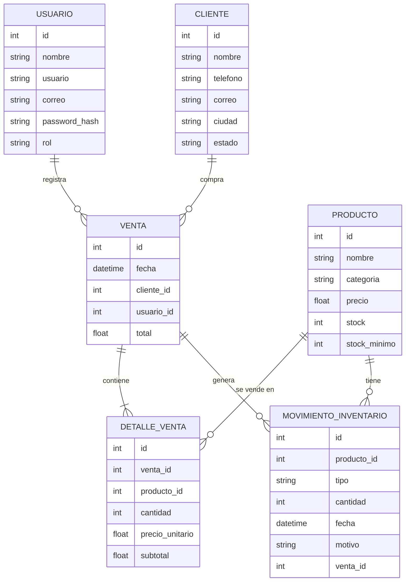

<p align="center">
  
</p>

<h1 align="center">GUMMY ERP</h1>

<p align="center">
  <strong>Python Data System</strong><br>
  Aplicación web académica para pequeños negocios: productos, inventario, ventas y clientes, con análisis de datos y un dashboard.
</p>

<p align="center">
  
  
  
</p>

<p align="center">
  
  
  
  
  
  
  
  
</p>

---

## Contenido

| | | |
|:---|:---|:---|
| [Descripción](#descripción) | [Instalación y ejecución](#instalación-y-ejecución) | [Credenciales de prueba](#credenciales-de-prueba) |
| [Módulos](#módulos) | [Arquitectura MVC](#arquitectura-mvc) | [Estructura del proyecto](#estructura-del-proyecto) |
| [Base de datos](#base-de-datos) | [Análisis de datos](#análisis-de-datos) | [Recursos gráficos](#recursos-gráficos) |

---

## Descripción

**GUMMY ERP** es un pequeño sistema ERP web desarrollado **completamente en Python**. Su objetivo no es solo registrar información, sino ayudar a un pequeño negocio a **entender sus datos**: qué se vende más, cuánto se ingresa por período, qué productos rotan poco y cuáles hay que reponer.

| Tecnología | Versión | Uso en el proyecto |
|:---|:---:|:---|
| Python | 3.12 | Lenguaje principal |
| Flet (+ flet-web) | 1.1.3 | Interfaz web (vistas) |
| SQLAlchemy | 2.1.9 | Modelos y conexión a la base de datos |
| SQLite | Incluido en Python | Base de datos local (`data/gummy_erp.db`) |
| Pandas | 3.1.1 | Análisis de datos (agrupaciones, totales, rankings) |
| Matplotlib | 3.11.2 | Gráficas del dashboard y de los reportes |
| bcrypt | 5.0.0 | Hash seguro de contraseñas |

---

## Instalación y ejecución

**Requisitos:** Python 3.12.

```bash
# 1. Crear y activar el entorno virtual
python -m venv venv
venv\Scripts\Activate.ps1          # Windows (PowerShell)
# source venv/bin/activate         # Linux / macOS

# 2. Instalar dependencias
pip install -r requirements.txt

# 3. Ejecutar
python main.py
```

La aplicación se abre en el navegador en **http://localhost:8550**.

En la primera ejecución, `main.py`:

1. Crea `data/gummy_erp.db` y sus tablas si no existen (`init_db()`).
2. Crea los dos usuarios de prueba si no hay usuarios.
3. Si la base no tiene productos ni ventas, carga datos de demostración desde `data/raw/*.csv` (71 productos, 36 clientes y 36 ventas del dataset de Olist).

Nunca se borra ni se sobrescribe una base existente. Para empezar de cero, cierra la app y borra `data/gummy_erp.db`.

---

## Credenciales de prueba

| Rol | Usuario | Correo | Contraseña |
|:---|:---|:---|:---|
| Administrador | `admin` | `admin@gummy.com` | `admin123` |
| Vendedor | `vendedor` | `vendedor@gummy.com` | `vendedor123` |

Se puede ingresar con el usuario **o** con el correo. Las contraseñas se guardan como hash **bcrypt** (`controllers/auth_controller.py`).

| Permiso | Administrador | Vendedor |
|:---|:---:|:---:|
| Dashboard | Sí | Sí |
| Productos: consultar | Sí | Sí |
| Productos: registrar, editar y eliminar | Sí | No |
| Inventario: consultar existencias y movimientos | Sí | Sí |
| Inventario: registrar entradas y salidas | Sí | No |
| Ventas: registrar y consultar | Sí | Sí |
| Clientes: registrar, consultar y editar | Sí | Sí |
| Clientes: eliminar | Sí | No |
| Reportes | Sí | No |

---

## Módulos

| Módulo | Qué hace |
|:---|:---|
| **Login** | Fondo `imagen-login.png`, formulario a la derecha con el logo, validación de campos y mensajes de error. |
| **Dashboard** | Tarjetas: total de ventas, productos registrados, productos con bajo inventario e ingresos totales. Gráficas: ventas por mes, productos más vendidos y distribución por categoría. Si no hay datos muestra ceros y un aviso. |
| **Productos** | Registrar, consultar (con búsqueda), editar y eliminar. Campos: nombre, categoría, precio, cantidad disponible y stock mínimo. No se puede eliminar un producto que aparece en ventas. |
| **Inventario** | Existencias, productos con bajo stock, historial de movimientos y registro de entradas y salidas. Cada cambio de stock queda registrado como movimiento. |
| **Ventas** | Seleccionar cliente (opcional), agregar varios productos con su cantidad, ver subtotales y total, y registrar. La venta descuenta el inventario automáticamente y valida que haya stock suficiente. Historial con detalle de cada venta. |
| **Clientes** | Registrar, consultar (con búsqueda), editar y eliminar. No se puede eliminar un cliente que tiene ventas. |
| **Reportes** | Resumen de ventas (ventas, ingresos, ticket promedio, unidades), ingresos por día, semana, mes o año, productos más vendidos, mayor y menor rotación, productos que necesitan reposición y resumen de movimientos. |

---

## Arquitectura MVC

| Capa | Carpeta | Responsabilidad |
|:---|:---|:---|
| **Model** | `models/` | Clases SQLAlchemy (tablas) y conexión a SQLite |
| **View** | `views/` | Pantallas Flet. No acceden a la base de datos |
| **Controller** | `controllers/` | Validan datos, aplican las reglas del negocio y usan los modelos |
| **Service** | `services/` | Análisis con Pandas, gráficas con Matplotlib y carga inicial de datos |



### Flujo de una venta



---

## Estructura del proyecto

```text
ERP GUMMY/
├── assets/
│   ├── Logo.png                     Logotipo (login y menú lateral)
│   ├── imagen-login.png             Fondo de la pantalla de inicio de sesión
│   └── Database Relationships...png Diagrama original del dataset de Olist
├── controllers/
│   ├── auth_controller.py           Login y hash bcrypt
│   ├── cliente_controller.py        CRUD de clientes
│   ├── dashboard_controller.py      Indicadores y gráficas del dashboard
│   ├── inventario_controller.py     Existencias, entradas, salidas y movimientos
│   ├── producto_controller.py       CRUD de productos
│   ├── reporte_controller.py        Datos de la pantalla de reportes
│   └── venta_controller.py          Registro y consulta de ventas
├── data/
│   ├── raw/                         CSV de demostración (ver data/raw/README.md)
│   └── gummy_erp.db                 Base SQLite (se crea sola, no se versiona)
├── models/
│   ├── database.py                  Engine, Base, get_session() e init_db()
│   ├── usuario_model.py             Usuario (rol administrador / vendedor)
│   ├── producto_model.py            Producto
│   ├── cliente_model.py             Cliente
│   ├── venta_model.py               Venta (encabezado)
│   ├── detalle_venta_model.py       DetalleVenta (productos de cada venta)
│   └── movimiento_model.py          MovimientoInventario (entradas y salidas)
├── services/
│   ├── analisis_service.py          Análisis con Pandas y gráficas con Matplotlib
│   └── carga_inicial.py             Usuarios de prueba y datos de demostración
├── views/
│   ├── componentes.py               Colores, tarjetas, tablas y diálogos comunes
│   ├── login_view.py
│   ├── dashboard_view.py
│   ├── productos_view.py
│   ├── inventario_view.py
│   ├── ventas_view.py
│   ├── clientes_view.py
│   └── reportes_view.py
├── Banner.png
├── main.py                          Punto de entrada y menú lateral
├── requirements.txt
└── README.md
```

---

## Base de datos

Seis tablas, creadas automáticamente por `init_db()`:



- `DetalleVenta` guarda el precio del momento de la venta, aunque el precio del producto cambie después.
- `MovimientoInventario.tipo` es `entrada` o `salida`. El stock de cada producto es igual a la suma de sus entradas menos sus salidas.

---

## Análisis de datos

Todo el análisis está en `services/analisis_service.py`. Cada función lee las tablas con `pd.read_sql()` y devuelve un resultado sencillo:

| Función | Resultado | Operación de Pandas |
|:---|:---|:---|
| `indicadores()` | Tarjetas del dashboard | `nunique`, `sum`, filtro por condición |
| `resumen_ventas()` | Ventas, ingresos, ticket promedio, unidades | `groupby("venta_id").sum()`, `mean` |
| `productos_mas_vendidos()` | Ranking por unidades | `groupby().agg()`, `sort_values`, `head` |
| `ventas_por_categoria()` | Ingresos por categoría | `groupby("categoria").sum()` |
| `ingresos_por_periodo()` | Ingresos por día, semana, mes o año | `dt.to_period()` + `groupby` |
| `rotacion_productos()` | Productos con mayor y menor rotación | `map` de unidades vendidas (incluye los que no se venden) |
| `productos_para_reponer()` | Productos en o bajo el stock mínimo y cantidad sugerida | filtro + `clip` (sugerido = mínimo × 2 − stock) |
| `resumen_movimientos()` | Entradas y salidas totales | `groupby("tipo").agg()` |

Las gráficas se dibujan con `matplotlib.figure.Figure` (sin `pyplot`, que no es seguro en un servidor web), se guardan como PNG en memoria y se muestran con `ft.Image`.

> Los datos de demostración vienen de pedidos reales de 2017 y 2018 (Olist). Las ventas que registres ahora aparecerán con la fecha actual.

---

## Recursos gráficos

| Recurso | Ruta | Uso |
|:---|:---|:---|
| Logotipo oficial | [`assets/Logo.png`](assets/Logo.png) | Login, menú lateral y cabecera de este README |
| Fondo del login | [`assets/imagen-login.png`](assets/imagen-login.png) | Fondo de la pantalla de inicio de sesión |
| Banner | [`Banner.png`](Banner.png) | Banner promocional del proyecto |

Los colores de la interfaz (naranja `#FF6B00`, rojo `#D72638`, morado `#7137C8` y dorado `#F2A900`) salen del logo y están definidos en `views/componentes.py` y `services/analisis_service.py`.

<p align="center">
  
</p>

---

<p align="center">
  <strong>GUMMY ERP</strong> · Equipo JOJO CEVIA · 2026<br>
  <sub>Proyecto académico</sub>
</p>
